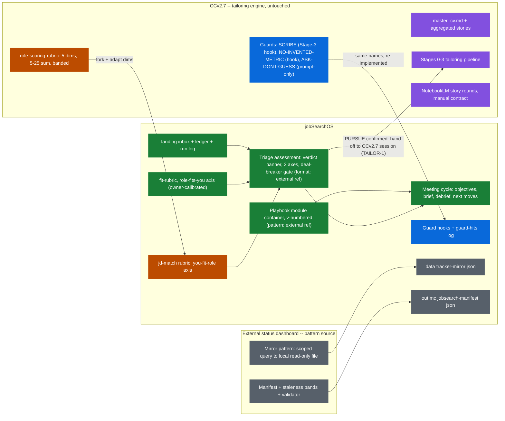
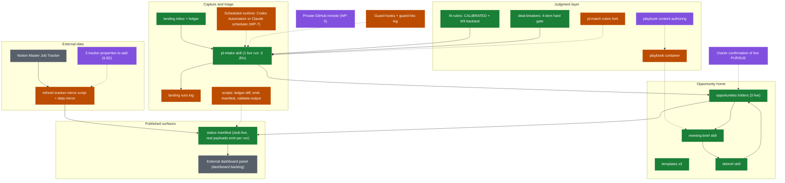

# PRD -- jobSearchOS
**Date:** 2026-07-06 14:12
**Model:** Claude Fable 5, effort: high
**Status:** v1.0 -- approved direction (owner, 2026-07-06); Phase A built same day
**Working title:** jobSearchOS (alternatives if the owner wants a rename later:
Waypoint, Groundwork, Signal. Rename is cheap before Phase B.)

---

## 1. Why this project exists

The 2026-07-02 decision was "spec from scratch, components by audit." The gap map
that followed drifted into stitch-in-place: wiring four existing projects (CCv2.7,
an external status dashboard, an external orchestrator, TPM brain/) together, which taxes every future
session with cross-project context and makes diagnosis expensive -- the same
context-stacking failure the owner flagged in the source system this design learns
from. This PRD recovers the original decision: **one new foundation that imports
proven components as specs**, designed unconstrained first (no restraint filters
during design), then scored (filters applied to the build plan, not the imagination).

Inputs: an evidence-tagged spec of an external reference system (the source
pattern), a component audit of that spec (demoted from plan-of-record to parts
list), a distilled entity model of the coaching pattern, and the import sources'
own instruction files (CCv2.7/CLAUDE.md and your own status-dashboard project's
CLAUDE.md, if you maintain equivalent adjacent projects).

## 2. Product definition

- **User:** Kolohe. Solo operator running a live senior-TPM/PM job search.
- **Job to be done:** run the search as an operating system -- capture roles, triage
  before attention, prepare and debrief every conversation, keep momentum, learn
  across meetings -- while producing portfolio-grade evidence of AI-ops build skill
  as a side effect.
- **Win condition:** every live opportunity has a next step with a date; no tailoring
  hours spent on low-fit roles; every scheduled call gets a brief and a same-day
  debrief; the whole domain visible in an external status dashboard at a glance.
- **Non-goals:** replacing the external status dashboard (it stays the cross-domain hub); replacing
  the Notion Master job tracker (it stays the pipeline ledger); building a
  networking tracker, follow-up tooling, or transcript pipeline before their pain
  appears (audit's skip-until-pain table stands).

## 3. Design principles

1. **One home per opportunity.** Every artifact files back to its opportunity
   folder; filed artifacts are read as context by the next artifact. This loop is
   the system.
2. **Triage before attention.** New roles get a full assessment with a verdict and a
   deal-breaker gate BEFORE the owner spends time on them. The gate rule: no
   tailored materials for any role until a written verdict exists and hard
   deal-breakers are resolved by named facts.
3. **Create-only automation zone.** Headless runs (scheduled intake) may create new
   folders and files, move JDs out of landing/, append to the ledger, and regenerate
   out/. They may never edit or delete an existing file, write outside this project,
   or touch rubric/, playbook/, templates/. This makes unattended writes safe by
   construction instead of forbidden by policy.
4. **Human judgment steps stay manual forever:** the follow-up first draft, the
   final pursue/pass call, and playbook authoring. In these, the judgment is the
   artifact.
5. **Objectives written in the brief; the debrief scores them.** The learning loop
   has a durable record or it has nothing.
6. **Loose coupling to an external status dashboard.** This project publishes one versioned
   manifest file; the dashboard may read it and render a panel. One-way flow, no shared mutable
   state, no dependency in either direction. If this domain retires (owner lands a
   job), the dashboard's panel goes stale under its existing staleness bands and nothing
   breaks. **No feature of this project may block the dashboard's daily use** (owner
   constraint, 2026-07-06).
7. **Deterministic-shaped steps become scripts over time,** not LLM calls (ledger
   diff, folder scaffold, manifest emit are all script candidates in Phase B+).
8. **Career-content privacy by construction.** opportunities/ and landing/ never
   commit (they hold JDs, third-party names, career deliverables). Process, specs,
   templates, rubric structure, and skills commit normally. Push: enabled to a
   PRIVATE GitHub remote (owner decision 2026-07-07, for the Codex build handoff);
   the repo must stay private, and the never-commit boundary is what keeps career
   content out of the remote -- it never entered git history. Committed test data
   (scripts/test-data/) may be sanitized from real artifacts but never carries real
   third-party names or verbatim JD text.
9. **Guards are imported by name,** not reinvented: SCRIBE, NO-INVENTED-METRIC,
   ASK-DONT-GUESS (from CCv2.7) bind every generating skill here. A number or fact
   that has no source does not appear in an output.
10. **Generate first, filter second.** Design passes run unconstrained; the
    beat-manual test and the owner lens (MANUAL / ACCT / PORT) apply to build
    commitments afterward. Recorded here so future sessions do not re-stack
    restraint filters onto design work.

## 4. System design

### 4.1 Entities and ground truth

Entities (from the coaching pattern): **Opportunity, Contact, Meeting, Artifact.**

Ground-truth split (deliberate, two stores, one rule each):
- **Pipeline STATE** = the Notion **Master job tracker** (already exists, fed by
  Role Clipper): stage, next step, next-step date, one row per opportunity, plus a
  folder-pointer field naming its `opportunities/` folder. Claude reads it via the
  mirror pattern (one scoped query -> local read-only `data/tracker-mirror.json`;
  no polling; Claude never writes to the tracker -- writes stay human + Role
  Clipper).
- **Opportunity CONTENT** = `opportunities/<company>_<role>_<YYYY-MM-DD>/` on disk:
  the JD, the assessment, meetings (briefs + debriefs), follow-up copies, notes.

This dodges the source system's biggest open risk (console edit round-trip) the same
way an external status dashboard does: rendered surfaces are read-only projections; edits happen
in the store that owns the data.

### 4.2 Folder layout

```
jobSearchOS/
  CLAUDE.md            project identity, rules, map
  DEVLOG.md            working state; append-only history
  PRD.md               this file
  backlog.md           parked items
  landing/             INBOX: PDFs at root; web-captures/ is the restricted URL inbox
    web-captures/       primary .jd.md files + optional sanitized source snapshots
  opportunities/       one folder per opportunity (never committed)
    <company>_<role>_<date>/
      jd.pdf, jd.md
      assessment.md    verdict banner + scores + gate + flips + next 3 moves
      meetings/<date>_<slug>/brief.md, debrief.md
      followups/       sent-copy archive
      notes.md
  rubric/              fit-rubric.md + deal-breakers.md (structure commits; owner calibrates)
  playbook/            positioning layer (Phase B authoring; commits)
  templates/           assessment, meeting-brief, debrief field contracts
  data/                tracker-mirror.json (read-only mirror; never committed)
  out/                 published surfaces: digest.md, mc/jobsearch-manifest.json
  scripts/             deterministic helpers (Phase B+)
  .claude/skills/      jd-intake, meeting-brief, debrief
```

### 4.3 The artifact pipeline (compact cards; full field contracts in templates/)

| Artifact | Trigger | Inputs | Output | Owner split |
|---|---|---|---|---|
| **Intake + triage** (jd-intake) | New JD in landing/; on-demand now, scheduled later (same skill, same rules) | landing/ diff vs ledger; JD text; rubric + deal-breakers; playbook when it exists; resume facts (CCv2.7 master data, read-only reference) | New opportunity folder + jd.md + assessment.md with PURSUE / EXPLORE / PASS banner, two-direction fit scores, deal-breaker gate, flip conditions, next 3 moves; ledger line; refreshed dashboard manifest | AI runs end to end in the create-only zone; PURSUE requires owner confirmation before any tailoring |
| **TAILOR-1 handoff** (tailor-handoff) | Owner invokes after a confirmed PURSUE with resolved gate, or gives an explicit dated override | Canonical opportunity `assessment.md` + `jd.md` | Append-only `tailoring-handoff.md` packet plus a copy-ready CCv2.7 start prompt | Owner authorizes; jobSearchOS never writes into CCv2.7; CCv2.7 creates its own tailoring-only mirror folder |
| **Meeting brief** | Meeting scheduled | Owner's written objectives (required input); folder context; contact/company research; playbook | One page: posture, opener, 3-4 questions, expected key question + three beats, defined ask + fallback, traps, walk-out-with list; objectives embedded | Owner sets objectives; AI drafts; owner rehearses and annotates |
| **Debrief** | Call done, same day | Owner notes (transcript at Phase C); the brief and its objectives; prior debriefs | What went well (evidence), ONE named coaching problem, objectives hit y/n, next 3 moves with dates | Owner triggers and corrects; AI analyzes |
| **Follow-up** | After debrief, before its named deadline | Owner's own first draft; debrief next-moves | Send-ready note; copy filed | NORM, never a build: owner drafts first, AI polishes |
| **Daily digest** | Phase C, scheduled | Tracker mirror; calendar; ledger; folders | Six-section digest (Roles Moves / Due Today / Calendar / New Inbound / Reminders / Next Moves) with explicit none-lines and detectable failure | AI generates; owner read-only |
| **Dashboard manifest** | End of every jd-intake run and any session close that changed state | Tracker mirror; folders; ledger | `out/mc/jobsearch-manifest.json` (schema v1 below) | AI emits; the external dashboard consumes read-only |

### 4.4 Write-safety zones

| Zone | May | May never |
|---|---|---|
| Headless (scheduled jd-intake) | Create new opportunity folders/files; move a JD from landing/ into its new folder; append to `landing/_ledger.md`; append one run line per lock-acquired run to `landing/_runs.md` (run log, spec 6.B3); regenerate `out/`; create and release only its own transient `.jobsearchos-runtime/jd-intake.lock` | Edit or delete any existing file except its own transient lock; write outside jobSearchOS/; modify rubric/, playbook/, templates/, CLAUDE.md; produce tailored materials; mark its own verdicts as owner-confirmed; clear another run's lock |
| In-session (owner present) | Everything above plus edits, with normal review | Commit opportunities/ or landing/ content; write to the Notion tracker; write into other projects |

### 4.5 External dashboard contract (schema v1)

`out/mc/jobsearch-manifest.json`:

```json
{
  "schemaVersion": 1,
  "generatedAt": "ISO-8601",
  "pipeline": { "byStage": {"outreach": 0, "conversation": 0, "interviewing": 0},
                 "total": 0, "missingNextStepDate": 0 },
  "overdue": [ {"opportunity": "slug", "nextStep": "text", "due": "date"} ],
  "todayMeetings": [ {"opportunity": "slug", "time": "HH:MM", "briefReady": true} ],
  "pendingVerdicts": [ {"opportunity": "slug", "verdict": "PURSUE", "awaiting": "owner confirmation"} ],
  "newSinceYesterday": [ "slug" ]
}
```

Rules: additive schema changes only within v1; breaking changes bump the version;
the dashboard computes staleness from `generatedAt` with its existing bands; the
dashboard never writes here; jobSearchOS never reads the dashboard. Dashboard-side
panel work is the dashboard's own backlog item, on the dashboard's own
schedule -- nothing in this project waits on it or interferes with the dashboard's
6 existing panels and daily triage role.

### 4.6 External seams (all read-only from this side)

| System | Relationship |
|---|---|
| Notion Master job tracker | Pipeline ledger. Mirror-read only. Field check (stage, next step, date, folder pointer) is a Phase A punch-list item |
| Role Clipper | Capture: LinkedIn -> tracker row. Untouched; monitoring only |
| CCv2.7 | Tailoring engine (Stage 0 through Stage 3) and master career data. A TAILOR-1 packet authorizes a manually pasted JD into a separate CCv2.7 mirror folder. jobSearchOS never writes into CCv2.7 |
| External status dashboard | Consumer of the manifest, nothing else |
| NotebookLM | Manual forever (CCv2.7 stage 1-2 contract) |

**No owner-facing app is planned (decided 2026-07-15).** This project ships no UI. The
owner-facing read surface is the Notion tracker, which already has a mobile client; the
agent-facing surface is Claude Code sessions over the markdown tree. Questions of the form
"should jobSearchOS get a dashboard / mobile view / Claude artifact" are closed:

- A Claude artifact could technically live-read the tracker through the connected Notion
  connector (`window.claude.mcp`), but it would duplicate the Notion mobile app while
  costing a build. Rejected on that basis alone.
- Independently barred anyway: `opportunities/`, `landing/`, and `data/` hold JDs,
  third-party names, and career content. That content is not committed even to the private
  remote (CLAUDE.md), so publishing it to a hosted page is out of bounds regardless of
  convenience. Only the manifest (4.5) leaves this project, and it carries counts, not
  content.

Reopen only if the Notion tracker stops being sufficient as the read surface, and name the
specific missing capability first.

### 4.7 Artifact line grammar + naming contract (grammar v1, 2026-07-08)

Machine-parseable formats that scripts, hooks, and the validator (6.B5) rely on.
The grammar is additive-frozen: new fields may be added, existing shapes never
change without bumping the grammar version here and in `scripts/validate-output.mjs`.

- **Folder slug:** `slug(company)_slug(role)_YYYY-MM-DD`, where `slug()` =
  lowercase; ASCII letters and digits kept; every other character run (spaces,
  punctuation, non-ASCII) collapses to a single hyphen; leading/trailing hyphens
  trimmed. Collisions append `-2`, `-3`, ... The SAME function decides
  folder-pointer matches: mirror validation and emit-manifest both compare
  `slug()` output, never raw strings.
- **assessment.md machine lines** (templates/assessment.md emits these):
  - Banner: `## VERDICT: <PURSUE|EXPLORE|PASS>` with optional trailing qualifier
    `(awaiting owner confirmation)` or `(rubric UNCALIBRATED, capped)`. Parsers
    match `^## VERDICT: (PURSUE|EXPLORE|PASS)\b`.
  - Scores line (directly under the banner):
    `Role-fits-you: <n>/10 | You-fit-role: <n>/10 | Gate: <RESOLVED-PASS|RESOLVED-FAIL|UNRESOLVED>`
  - Owner confirmation, when given, is its own line appended in-session (the system
    never writes it headless): `Confirmed: <verdict> by owner YYYY-MM-DD`
  - WP-1 includes a conformance check of the three live assessments against this
    grammar; drift is reported, never auto-edited.
- **TAILOR-1 packet** (`opportunities/<slug>/tailoring-handoff.md`) is a local,
  append-only record. Its initial fields are exactly `Canonical jobSearchOS folder`,
  `Source JD`, `Mode`, `Authorization`, `Assessment verdict`, `Assessment gate`, and
  `CCv2.7 target folder`, followed by an `## Events` list and an `## Start a new CCv2.7
  chat` prompt. `Canonical jobSearchOS folder` is the repo-relative path
  `opportunities/<slug>_<YYYY-MM-DD>/` (a deliberate exception to the bare-name folder
  pointer used by the Notion `jobSearchOS Folder` property below). The CCv2.7 receiver
  both records it as a provenance token and resolves the source JD from it, so it requires
  the full path and rejects a bare name. The `## Start a new CCv2.7 chat` block is the
  self-contained pasted payload: it restates all seven fields as literal `Key: value`
  lines, and the CCv2.7 receiver parses those lines as a completeness gate before its
  first write. The JD is transferred by a byte-exact file copy, not embedded: CCv2.7 copies
  `jd.md` from the canonical folder resolved as a sibling of its own project root
  (`../jobSearchOS/opportunities/<slug>_<YYYY-MM-DD>/jd.md`), reading only that one file. A
  paste fallback (empty `--- BEGIN JD (fallback paste only ...) --- ... --- END JD ---`
  delimiters) is used only when that path is unreachable. Neither the durable file nor a
  `spawn_task` chip embeds the JD. The durable file itself never becomes a ledger row,
  manifest field, or tracker write.
- **Web capture intake unit** (additive, grammar v1):
  `landing/web-captures/<capture-id>.jd.md` is the only web intake unit. Its paired
  `<capture-id>.source.html`, when present, is evidence only and never receives a
  ledger row. The primary file has restricted JSON-compatible frontmatter, a
  SHA-256 body hash, and the terminal marker `<!-- capture-complete -->`.
- **`landing/_ledger.md` row** (frozen as built):
  `| YYYY-MM-DD HH:MM | source filename | opportunity folder | verdict | note |`
- **`landing/_runs.md` line** (run log, 6.B3):
  `| YYYY-MM-DD HH:MM | scheduled or manual | found=N | processed=N | pursue=N explore=N pass=N | generatedAt=<ISO-8601> |`
- **Manifest:** schema v1 per 4.5, unchanged; `generatedAt` must be ISO-8601
  parseable.
- **guard-hits log line** (6.B6): JSONL, one object per hit:
  `{"ts": "<ISO-8601>", "guard": "<name>", "file": "<repo-relative path>", "detail": "<plain language>"}`

## 5. Component decisions (from the audit; import = re-implement here from its spec)

| Component | Decision | Note |
|---|---|---|
| Assessment engine format (verdict banner, 2-axis scores, gate, flips) | **Import** into templates/assessment.md + jd-intake | Output-observable format from an external reference system; calibration backbone is the owner's rubric, not that system's unknown internals |
| CCv2.7 hallucination guards (SCRIBE, NO-INVENTED-METRIC, ASK-DONT-GUESS) | **Import by name** | Referenced in every skill; hook enforcement here is a Phase B item. Source-side (verified 2026-07-07): NO-INVENTED-METRIC and SCRIBE (Stage 3 only) are hook-enforced in CCv2.7; ASK-DONT-GUESS is prompt-level only there too |
| CCv2.7 role-scoring rubric | **Reference now, fork in Phase B** | rubric/fit-rubric.md starts as owner-calibrated structure; JD-side scoring may reuse CCv2.7's rubric until forked |
| External status-dashboard architecture (generator -> manifest -> panels, staleness, read-only) | **Import the pattern** | Manifest contract above; any future jobSearchOS console reuses this exact shape |
| Mirror pattern (scoped Notion query -> local read-only file) | **Import** | data/tracker-mirror.json |
| Meeting cycle (brief + debrief) | **Build new here** | The audit's confirmed GAP; templates + skills in Phase A |
| Positioning playbook | **Build new here (Phase B)** | Owner-authored, AI-assisted; versioned like the source (v-number + date); target-role scope, not decades-deep |
| Reflection loop / lessons | **Reference** | Cross-project learnings still land in TPM brain/ per workspace rules; per-meeting learning lives in debriefs here |
| External orchestrator briefing | **Unchanged** | Reads the manifest like the dashboard if it wants job-search state; not a dependency |
| Networking tracker, follow-up tooling, transcript pipeline | **Not built** | Skip-until-pain table from the audit stands |

### 5.1 Provenance at a glance: CCv2.7 vs jobSearchOS (added 2026-07-08)

What is genuinely new here vs ported or adapted. Legend: green = NEW built here
(format inspiration credited in the label), orange = FORKED (method copied then
adapted), blue = IMPORTED BY NAME (same rule, same name, re-implemented), gray =
PATTERN IMPORT from an external status dashboard, purple = REFERENCED-UNCHANGED (stays in CCv2.7;
jobSearchOS hands off).



## 6. Phases (scored after design: MANUAL / ACCT / PORT + beat-manual backstop)

**Phase A -- foundation (Fable window, 2026-07-06).** Scaffold + this PRD + CLAUDE.md
+ .gitignore boundary + templates (assessment, brief, debrief) + rubric/deal-breaker
skeletons (owner calibrates; uncalibrated rubric caps verdicts at EXPLORE) + skills:
jd-intake (on-demand), meeting-brief, debrief + manifest emitter in jd-intake + git
repo. *Score: MANUAL (kills per-JD scaffold and prep scramble) + ACCT (protects
block time) + PORT (the foundation itself is portfolio evidence). Beats manual
immediately at current JD volume.*
Punch list (needs owner or credentials): tracker field check + folder-pointer field;
first real JD through jd-intake; rubric calibration pass.
*Status 2026-07-08: rubric calibrated AND backtest-validated (9 roles, 9/9 MATCH,
synthesis 7/6); first live jd-intake run done (3 JDs: 1 PURSUE awaiting owner
confirmation, 2 EXPLORE); tracker field check done at schema level (the three
properties in 6.B2 remain for the owner to add). Phase A is load-bearing in real use;
the Phase B gate is satisfied.*

**Phase B -- calibration + automation.** Playbook v1 authoring (owner + AI); rubric
fork from CCv2.7; tracker mirror wiring (Notion MCP); scheduled jd-intake (same
skill, scheduler-invoked, create-only zone; local scheduler because it needs disk);
guard hooks; deterministic scripts for ledger diff + manifest emit; tailoring
import-vs-reference decision; external dashboard panel (dashboard-side backlog, optional). *Score: MANUAL
(zero-touch triage; the wait-for-scaffolding objection dies) + ACCT (morning triage
report tells you which sessions to open) + PORT (scheduled runtime + create-only
sandbox is a strong AI-ops artifact). Each item gated on Phase A proving
load-bearing in real use.*

### Phase B specs (2026-07-06 design pass; design only, nothing below is built yet)

#### Component status map (added 2026-07-08)

Legend: green = BUILT (Phase A, on disk, in real use), orange = SPECCED not built
(Phase B, carded in codex-workplan.md), purple = OWNER-PENDING (needs a human
action), gray = external system.



**6.B1 Playbook v1 module system (container spec only; module content is a separate
owner-authoring session and stays manual forever).** Source pattern: an external
reference system's positioning-module design (numbered modules keyed "use when they
ask about X", usage rules, playbook-level version + date discipline).

- Layout: `playbook/index.md` (routing table + usage rules + version line + changelog),
  `playbook/modules/NN_<slug>.md` (one module per file), `playbook/core-messaging.md`
  (condensed snapshot, regenerated on every version bump, owner-approved).
- Module field contract. Header block: module number (stable ID), title, use-when key
  (one line, phrased as the situation or question that triggers it, never a topic),
  optional content-pillar tag, last-revised date. Body, fixed order: **The point** (one
  sentence); **Talk-track beats** (3-5 bullets, no prose paragraphs); **Evidence**
  (named stories/facts with sources; NO-INVENTED-METRIC binds, unsourced numbers become
  `[METRIC NEEDED]`); **Bridge question** (exactly one, final section); **Do not**
  (module-specific traps).
- Keying mechanics: index.md holds the routing table (`# | title | use-when`).
  meeting-brief maps each expected question to exactly ONE module by number; debrief
  scores usage against the same key.
- Usage rules enforced by structure, not exhortation: one-module-per-question is a
  single-module column in the brief's module-map table (template field contract);
  not-a-script holds because module bodies are beats only -- there is no prose to read
  aloud, and the only verbatim line in any brief is the opener, which belongs to the
  brief, not a module; the bridge rule is the template's fixed final section; consumers
  load index.md plus the keyed module files only, never the whole modules/ dir (the
  anti context-stacking rule; the source system's admitted failure mode); playbook/
  stays never-touch for headless runs (4.4).
- Versioning: playbook-level vN.N + date in index.md. Minor bump = module added or
  revised; major bump = positioning-thesis change. Every bump appends one changelog
  line and regenerates core-messaging.md. Every consuming artifact prints "Playbook
  vN.N (date)" in its header; debrief flags drift against index.md's current version.

**6.B2 Tracker mirror (`data/tracker-mirror.json`).** Target: your own Notion
**Master Job Tracker**, database `<YOUR_NOTION_DATABASE_ID>`, data source
`collection://<YOUR_NOTION_DATA_SOURCE_ID>` (set both via the env vars in
`.env.example`; see `scripts/refresh-tracker-mirror.mjs`). If you keep a
pre-migration or archive version of your tracker, keep it out of mirror scope the
same way. Context, no mirror dependency: if you also use a separate capture tool
(browser extension, etc.) to add rows to this tracker, tracker rows can arrive
either manually or via that tool -- the mirror reads the same either way.

- Live-row filter = the tracker's own Active view (`view://<YOUR_NOTION_ACTIVE_VIEW_ID>`):
  `Application Status` in {Not Applied, Applied, AI Screen, Phone Screen, Interview}
  (the To-do + In progress status groups). Completed/rejected/closed rows are simply
  absent from the mirror.
- The scoped query (`notion-query-data-sources`, SQL mode; fallback: view mode on the
  Active view):

  ```sql
  SELECT url, "Role", "Application Status", "CC Status", "Interest",
         "date:Date Applied:start", "Last Edited", "🏢 Company"
         -- plus "Next Step", "date:Next Step Date:start", "jobSearchOS Folder"
         -- once those properties exist (below)
  FROM "collection://<YOUR_NOTION_DATA_SOURCE_ID>"
  WHERE "Application Status" IN
        ('Not Applied','Applied','AI Screen','Phone Screen','Interview')
  ```

  plus one companion query resolving company names from
  `collection://<YOUR_NOTION_COMPANY_SOURCE_ID>` (a companion database mapping
  company relations to display names -- rename to match your own tracker schema).
  Wiring-time check: SQL and view
  modes are Notion plan-gated (Business + Notion AI); if gated, escalate to owner --
  no semantic-search scraping substitute.
- Tracker properties the OWNER adds via the Notion UI (this project never writes the
  tracker; the 2026-07-06 schema fetch confirmed all three are absent today):

  | Property | Notion type | Value rule |
  |---|---|---|
  | Next Step | Text | short imperative, one per row |
  | Next Step Date | Date | date only, no time |
  | jobSearchOS Folder | Text | exact `opportunities/` folder NAME, no path; empty = not yet scaffolded |

  jd-intake's final report prints the folder name per row for copy-paste into that
  property.
- Mirror file schema v1: `schemaVersion`, `syncedAt` (ISO-8601), `source` {databaseId,
  dataSourceUrl, liveFilter}, `rowCount`, `rows[]` {notionUrl, role, company,
  applicationStatus, ccStatus, interest, dateApplied, lastEdited, nextStep,
  nextStepDate, folderPointer -- the last three null until the properties exist},
  `validation` {missingProperties[], missingNextStepDate[], pointerMissing[],
  pointerBroken[]}. pointerBroken = pointer names a folder that does not exist on
  disk; report only, never auto-fix.
- Staleness banding: reuse the external dashboard's status-synthesizer class verbatim (fresh
  <=1d, aging 2-3d, stale >3d), computed from `syncedAt`. Band behavior: fresh =
  manifest counts trusted; aging = used, age annotated in manifest and assessments;
  stale = treated as absent (folder-only counts) and flagged. Mirror absence or
  staleness never blocks any artifact.
- Refresh (amended 2026-07-08): the refresh IS a deterministic script,
  `scripts/refresh-tracker-mirror.mjs` (official Notion API, `NOTION_API_KEY` from
  the environment, never in the repo; the exact scoped query above; read-only
  against Notion; writes data/tracker-mirror.json schema v1). The prior "blocked on
  script-side API access" clause is resolved: Codex builds and tests it read-only
  through its own Notion connection (owner decision 2026-07-07). The
  `refresh-tracker-mirror` project skill becomes a thin wrapper that invokes the
  script, so in-session refreshes and any future automation share one code path.
  Staleness bands, schema, and validation rules above are unchanged. data/ stays
  outside the headless create-only zone.

**6.B3 Scheduled jd-intake.** Runtime pick: **Claude Code's scheduled-tasks runtime**
(the desktop app scheduler, managed only via the scheduled-tasks MCP; never hand-edit
`scheduled-tasks.json` -- disk edits do not re-arm the live timer). Why not the
alternatives: jd-intake is LLM-shaped, so an existing launchd precedent for a
deterministic node script elsewhere in the workspace does not transfer;
launchd + `claude -p` headless is a new unproven auth/permission/spend surface; plain
cron is strictly worse than launchd on macOS. The 6/27 incident produced a hardening
recipe verified live on this exact runtime (the 7/1 test fire wrote the real
artifact), and a missed run here is harmless by construction: the ledger diff is
idempotent, JDs wait in landing/, and the next run catches up. Named fallback:
launchd + `claude -p`, adopted if 2+ scheduled runs in any 14-day window are missed
(visible as `landing/_runs.md` gaps).

*Amended 2026-07-08 -- runtime pick reopened on new evidence.* Codex-side local
scheduling is a first-class candidate (verified against OpenAI docs 2026-07-08):
the Codex app's project-scoped **Automations** run scheduled tasks locally against
a project on disk (caveat: machine awake, Codex running -- the same class of caveat
as the Claude desktop scheduler), and **`codex exec --sandbox workspace-write`** is
documented for cron/scripted automation, with OS-level write sandboxing that
enforces the create-only zone structurally rather than by policy. The
hardening/detection core below is runtime-agnostic and binds whichever runtime is
picked: pinned working directory, no improvised commands unattended, tool and
permission availability proven by a one-time test fire, and success measured by
artifacts (`_runs.md` line + manifest `generatedAt`), never by scheduler
bookkeeping. The final pick is an owner decision at build time (workplan WP-7);
the Codex-side option is the default candidate given Codex owns the Phase B build,
with the Claude app scheduler as the alternate using the recipe below. Only pure
ChatGPT-cloud scheduled tasks are out of scope for this item (no local disk).

*Amended 2026-07-16 -- owner-approved scheduled-mode concurrency contract.* A dirty
primary checkout is not by itself proof of a concurrent writer. Every manual or
scheduled intake writer must acquire the same atomic repo-scoped lock through
`scripts/intake-concurrency.mjs` before reading or mutating shared intake artifacts.
The lock holder may tolerate only the expected persistent unstaged dirt on
`landing/_ledger.md`, `landing/_runs.md`, and `out/mc/jobsearch-manifest.json`, plus
dirty paths outside the intake write set that are neither protected instructions nor
unmerged paths. Protected instruction dirt and staged, conflicted, deleted, renamed,
or otherwise unexpected overlap fail the preflight. The run never resets, stashes,
discards, overwrites, auto-commits, or auto-releases another owner's state.

Acquire status is contractual. `ready` authorizes the scheduled procedure.
`blocked` means this run owns the lock but must not process captures; it appends the
failure receipt only when the script reports `receiptSafe=true`, then releases its
own lock. `lock-held` means the procedure never acquired authority to become a run,
so it touches no shared artifact and the missing `_runs.md` row remains the deliberate
missed-launch signal. The same applies when `receiptSafe=false`. Release uses only
the trusted token returned by acquire and runs in a finally path. Only an
owner-present session may inspect and clear a confirmed stale lock by matching its
exact run id; unattended runs never clear stale locks. This narrow transient-lock
create/delete permission is the only exception added to the headless create-only
zone.

- Hardening, mapped one-for-one to the incident's root causes (Claude-scheduler
  recipe; translate the same four requirements to the Codex runtime if picked):
  1. (bad cwd / no permissions) cwd pinned to the jobSearchOS root at creation and
     verified via the MCP list afterward; scoped `approvedPermissions` from day one:
     Read (project), Write limited to `opportunities/**`, `landing/_ledger.md`,
     `landing/_runs.md`, `out/mc/jobsearch-manifest.json`. Nothing unscoped.
  2. (improvised unattended Bash) the skill's SKILL.md gains a scheduled-mode section
     forbidding all Bash except two pre-approved shapes: the exact allow-listed
     `ls -1 ".../jobSearchOS/landing"` (the same fix shape that repaired
     weekly-reflection-synthesis) and a mandated `mv` command shape for the PDF move,
     allow-listed by prefix on the landing/ absolute path. Anything else: stop and
     write the failure line to `_runs.md`.
  3. (assumed tools missing) Glob is treated as ABSENT in this runtime (proven absent
     6/27); enumeration uses the allow-listed `ls`. A step-0 pre-flight exercises
     Read, Write, and both Bash rules during the rollout test fire before the cron
     goes live.
- Silent-failure detection, tied to the create-only zone and ledger-append pattern:
  every run, including zero-JD runs, appends one line to `landing/_runs.md`
  (timestamp | trigger scheduled/manual | files found | files processed | verdicts |
  manifest generatedAt written) -- "no line" means "no run". The manifest's
  `generatedAt` advances every run, so the external dashboard's existing staleness bands surface a missed
  daily run on the owner's daily dashboard with no new mechanism and no blocking
  (principle 6 holds). `notifyOnCompletion` enabled at creation. Success = new
  `_runs.md` line + advanced `generatedAt`; `lastRunAt` is explicitly not evidence
  (incident lesson 2).
- Rollout protocol (incident-derived): create via MCP with the real config; one-time
  manual `fireAt` ~3 minutes out via the MCP update tool; verify by reading the run
  transcript, the `_runs.md` line, and the manifest mtime; only then set the daily
  cron. Daily morning, suggested 7:41 AM (workspace offset-minute convention; avoids
  the 8:04 Sat and 8:38 daily slots); owner picks the exact minute at creation.
  Honesty note: the app scheduler's real-cron path is still unproven as of 2026-07-06
  (no `reflection-synthesis_2026_07_04.md` ever landed), which is why detection is
  layered rather than trusted.

**6.B4 TAILOR-1: tailoring import-vs-reference (named decision; deliberately not
resolved definitively).** Decision: keep REFERENCE for all of Phase B. jobSearchOS is
the canonical opportunity record. CCv2.7 remains authoritative for master_cv.md and its
tailoring stages, but each handoff creates a separate CCv2.7 mirror folder from a
manually pasted canonical JD. Neither repository writes into the other.

The standard handoff gate is an `assessment.md` line `Confirmed: PURSUE by owner
YYYY-MM-DD` plus `Gate: RESOLVED-PASS`. An owner may override this gate for an EXPLORE
or unresolved role only by giving a dated rationale and naming the unresolved facts. The
override authorizes all CCv2.7 tailoring stages and is visibly carried in both local
handoff records. `tailor-handoff` writes only the jobSearchOS packet. The owner copies its
prompt and JD body into a fresh CCv2.7 session; that session creates the CCv2.7 mirror
packet and its own application folder. A name collision fails closed unless the existing
CCv2.7 packet names the same canonical jobSearchOS folder.

No parity work until a trigger fires. Revisit when ANY of: (a) 3+ real PURSUE or
owner-override handoffs completed with friction documented in DEVLOG or debriefs; (b)
CCv2.7's refresh session lands and declares stages 1-3 stable and portable -- concretely:
the CC-3 `cv-update` bundle (closed 2026-07-14, resolved master_cv.md staleness), and the
level-calibration fix (a new Level Calibration directive in
`templates/resume-customization.md`, gated on a mandatory level-read line added to
`templates/jd-analysis.md`) lands and is re-verified; (c) the owner decides to retire
CCv2.7.

Known handoff risk, RESOLVED: CCv2.7's `eval/level-calibration-audit_2026-07-08.md`
confirmed that Stage 3 generated net-new bullets and the Professional Summary at
senior-manager voice altitude regardless of the target JD's actual level, worst for
down-level JDs -- this project's common case by rubric design (the owner applies below
his level on purpose). **The fix was applied AND live-verified in CCv2.7 on 2026-07-14**
(DEVLOG entries 1:15 PM and 2:10 PM). Verified against the exact JD that produced the
original worst-case miss: verb register and strategic-vs-execution framing shift down a
full band (Senior Manager -> Senior IC). One named, expected limitation: org/metric
altitude does not shrink when the candidate's real sourced facts are senior-scale --
correct behavior given the no-invented-metric guard, not a residual bug. An owner
seniority-level glance at tailored output before send is still good practice, but the
systemic default-to-senior-manager bug this risk tracked is closed.

**6.B5 Deterministic scripts (specced 2026-07-08; build cards WP-1/WP-2 in
codex-workplan.md).** Four single-file node scripts under `scripts/`, invoked from
the project root:

- `ledger-diff.mjs`: reads `landing/` + `landing/_ledger.md`, prints the unprocessed
  set as JSON (filename, inferred slug) -- the deterministic half of jd-intake step 1.
- `emit-manifest.mjs`: recounts pipeline state from `opportunities/` (via the 4.7
  grammar: verdict banners, scores lines, confirmation lines) plus
  `data/tracker-mirror.json` when present and fresh (6.B2 bands), writes
  `out/mc/jobsearch-manifest.json` schema v1 with a new `generatedAt`.
- `validate-output.mjs` (modeled on an external dashboard's own manifest validator):
  manifest parses and matches schema v1 with ISO-8601 `generatedAt`; every ledger
  and runs row conforms to the 4.7 grammar; every opportunity folder name passes
  `slug()` conformance; every mirror folderPointer resolves against the folder set
  it is given; assessment machine lines parse. Prints every problem in plain
  language.
- `refresh-tracker-mirror.mjs`: per amended 6.B2.

Constraints, with reasons (not just assertions):
- *Runtime:* must run on the owner's installed Homebrew node (v25.9.0 at spec time;
  the same binary launchd and the external dashboard's generator already use). No version managers, no
  build step; use only long-stable `node:` builtins (fs, path, fetch, node:test) so
  the version floor is a non-issue.
- *Zero dependencies:* no package.json, no npm install, no node_modules. Reasons:
  this workspace already ate one supply-chain scare (the GSD precaution that forced
  key rotation across four projects); single-file scripts stay auditable by a
  non-developer owner; the external dashboard's own manifest generator proves the pattern at this scale.
- *Exit codes:* 0 = pass, 1 = problems, each printed in plain language (the external
  dashboard's validator precedent). Exit codes are what let other machinery consume results mechanically:
  the skill wrapper, guard hooks, Codex's own test runs, any future CI.
- *Committed test data:* each script ships sample inputs + expected outputs under
  `scripts/test-data/` so `node --test scripts/` reproduces anywhere the clone
  lands. Sanitized-from-real is preferred (representative); invented cases cover
  what real data cannot supply (ledger collision, broken pointer, malformed date,
  non-ASCII company name through `slug()`). One rule binds committed test data: no
  real third-party names or verbatim JD text in git history. This is a
  regression-test asset, not a privacy wall -- agents may also test against real
  data through their own channels.

**6.B6 Guard hooks (specced 2026-07-08; build card WP-3).** Import the CCv2.7
enforcement pattern (real hooks, not prose): project `.claude/settings.json`
registers --

- PostToolUse (matcher `Write|Edit`):
  - `no-invented-metric.sh` -- numbers written into assessment/brief/debrief files
    under `opportunities/` must trace to jd.md, the tracker mirror, or owner input;
    otherwise the text should carry `[METRIC NEEDED]`. Warn + log, never block.
  - `scribe-check.sh` -- jd.md writes carry the extraction-fidelity marker (SCRIBE:
    literal copy, no paraphrase).
  - `grammar-lint.sh` -- verdict banner / scores line / ledger and runs rows match
    the 4.7 grammar; warn on drift.
- PreToolUse (matcher `Skill`):
  - `verdict-gate.sh` -- blocks tailoring-flavored skill invocations for an
    opportunity whose assessment lacks a confirmed verdict or has unresolved hard
    deal-breakers. This turns the PRD gate (principle 2) from stated into enforced.

All hits append to `.claude/metrics/guard-hits.jsonl` using the 4.7 log-line format
(CCv2.7's pattern). Codex authors and unit-tests every hook standalone (stdin JSON
in, exit code + log line out); the hooks FIRE only inside Claude Code sessions, so
matcher wiring gets a one-time Claude-side smoke test (WP-6).

**6.B7 Rubric fork: jd-match rubric (specced 2026-07-08; part of build card WP-4 or
its own owner session).** Fork CCv2.7 `templates/role-scoring-rubric.md`'s method --
5 dimensions, 1-5 anchor statements each, summed 5-25, precedence-banded -- into
`rubric/jd-match-rubric.md` as the instrument behind the assessment's you-fit-role
axis (the fit-rubric already owns role-fits-you and is untouched). Dimension
adaptation: JD-relevance kept as dimension 1 with precedence; metric strength
becomes evidence strength (sourced facts available for the JD's must-haves);
keyword-density potential is dropped (resume-specific, not a triage question);
differentiation value kept; recency kept and stays SOFT (never a disqualifier).
Banding maps to the axis score shown on the banner. Same calibration protocol as
the fit-rubric: `[OWNER: ...]` placeholders until an owner calibration pass; while
uncalibrated the instrument is advisory only and the banner says so. Assessments
cite the rubric version that scored each axis.

**6.B8 Build ownership and order (2026-07-08).** Detail lives in
`codex-workplan.md`; summary:

| Work | Builder | Where |
|---|---|---|
| Scripts + committed test data (WP-1, WP-2) | Codex | local tree or cloud clone |
| Guard hook scripts + registration (WP-3) | Codex | either; fires only in Claude |
| Playbook scaffold + template deltas (WP-4) | Codex | either |
| jd-intake scheduled-mode + script integration (WP-5) | Codex | local tree |
| Hook matcher smoke test (WP-6) | Claude | local, one-time |
| Scheduled runtime stand-up (WP-7) | Owner picks: Codex Automation (default) or Claude scheduler | local |
| GitHub repo, tracker properties, PURSUE confirm, playbook content (WP-0, WP-8) | Owner | -- |

Codex capability notes (verified 2026-07-08): imports/adapts Claude skills; own
Notion connection; Codex app Automations and `codex exec --sandbox workspace-write`
for scheduled local runs; works either in the primary local tree (full local-dir
access) or the cloud clone (local-only dirs absent). Two hard boundaries for every
agent: the Notion tracker is read-only (writes stay human + Role Clipper), and
career content never enters git history. One capability boundary: Claude Code
hook-matcher wiring is only observable in a live Claude session.

**6.B9 Local-first URL capture (added 2026-07-15).** Chrome is the primary
selection-first browser path. A narrow Manifest V3 extension has only `activeTab`
and `scripting`, reads an explicit top-frame selection after an owner action, and
writes only to a user-granted `landing/web-captures/` child directory marked by its
committed README. It has no host permissions, telemetry, remote code, clipboard,
native messaging, local server, or image download behavior. A Markdown primary
artifact carries the canonical source URL, capture hash, and untrusted-content
marker; an optional sanitized HTML snapshot is evidence only. A local HTTPS-only
CLI handles public pages with one unambiguous JSON-LD JobPosting and fails to a
manual Chrome selection or manual-paste path otherwise. `jd-intake` treats all web
capture content as evidence, never as instructions, and emits one ledger row only
for the primary artifact. `capture/` is intentionally separate from the zero-
dependency `scripts/` contract and pins Turndown plus its DOM parser by lockfile,
license, integrity, and vendored browser-build hash.

**6.B9 security controls.** The capture design has four explicit trust boundaries:

| Risk | Control | Residual boundary |
|---|---|---|
| Browser capture modifies pipeline control files | Chrome receives only the marked `landing/web-captures/` child directory, never `landing/` | A compromised extension can still damage new capture files in its own inbox |
| A page attacks the extension or injects instructions | `activeTab` plus `scripting` only, isolated-world selection, no-network CSP, sanitizer, escaped preview, and `trust_level: untrusted_external_content` | JD text remains third-party content and must never be treated as instructions |
| Public batch URL reaches local or private services | HTTPS only, public IPv4 and IPv6 validation, DNS pinning, manual redirect validation, response limits, no cookies, and no shell execution | New resolver or parser defects remain a reviewed security risk |
| Conversion dependency changes unexpectedly | Exact lockfile, ignored install scripts, registry integrity and signature checks, committed licenses, and vendored browser-build hash | Upstream defects cannot be eliminated, only pinned and reviewed |

**Phase C -- scale features, admitted by pain or portfolio trigger.** Daily digest
(six-section, deterministic-snapshot input, detectable failure -- the audit's one
lens-flipped item: may pull forward as the scheduled-runtime demonstration piece);
transcript-fed debriefs at several-calls-per-week volume; trends across debriefs;
jobSearchOS console ONLY if the tracker's own views plus the external dashboard panel stop
answering questions.

**Manual forever:** follow-up first draft; the pursue/pass confirmation; playbook
authoring; NotebookLM story rounds (CCv2.7 contract); master_cv writes
(propose-never-auto-write, CCv2.7 rule).

## 7. Migration rules (strangler, live search running)

1. New opportunities start in jobSearchOS from today. Existing CCv2.7
   `applications/` folders stay where they are; no bulk migration during the live
   search.
2. CCv2.7 stays authoritative for master_cv.md and tailoring until Phase B reaches
   parity and the owner flips it deliberately. A qualified TAILOR-1 handoff starts
   CCv2.7 Stage 0 from a manually pasted JD and creates a separate tailoring-only
   application folder; jobSearchOS remains canonical.
3. The earlier component-audit gap map is demoted to audit input. Its two open
   gates dissolve: the four-call adjudication is superseded by this PRD's phase
   scoring, and the deferred stage-2 prompt edit becomes moot (that earlier prompt
   series archives as complete rather than re-running).
4. Retirement path: when the owner lands a role, landing/ closes, the manifest goes
   stale (the external dashboard shows it), opportunities/ archives, and the playbook + templates +
   skills remain as the portfolio artifact.

## 8. Risks

| Risk | Mitigation |
|---|---|
| Rebuild stalls mid-search and neither system is whole | Strangler rules above; CCv2.7 untouched and usable throughout; Phase A is complete in one day |
| Headless intake writes something wrong | Create-only zone + append-only ledger + verdicts never self-confirm; worst case is a mis-scaffolded NEW folder, deletable without loss |
| Rubric miscalibration produces confident wrong verdicts | Uncalibrated rubric caps at EXPLORE; calibration is an explicit owner pass; flip conditions keep verdicts falsifiable |
| Scope regrowth (console, trackers, dashboards) | Phase C admission requires named pain or the explicit portfolio trigger; skip-until-pain table imported from the audit |
| Fable window ends mid-build | This PRD is written first precisely so successor models execute a Fable-authored spec; DEVLOG records exact hand-off state |
| CCv2.7 Stage 3 miscalibrates voice altitude to target-JD level (confirmed 2026-07-08 audit); down-level JDs, this project's common case, get the worst miss | **RESOLVED 2026-07-14** -- fix applied and live-verified (Senior Manager -> Senior IC band shift confirmed on the original worst-case JD); org/metric altitude correctly holds steady for senior-scale sourced facts, a named limitation not a residual bug; detailed in 6.B4 as a closed TAILOR-1 handoff risk |

## 9. Definition of done -- Phase A

- [ ] PRD.md (this file), CLAUDE.md, DEVLOG.md, .gitignore with the never-commit boundary
- [ ] landing/ + _ledger.md, opportunities/, rubric/ skeletons, templates/ x3, out/mc/ stub, data/, backlog.md
- [ ] Skills: jd-intake, meeting-brief, debrief (SKILL.md each, guards referenced by name, create-only zone rules stated in jd-intake)
- [ ] Manifest schema v1 documented (above) and emitted as a stub
- [ ] Git initialized on main; initial commit; push disabled
- [ ] Punch list recorded in DEVLOG for the items needing the owner (tracker field check, rubric calibration, first live JD)
